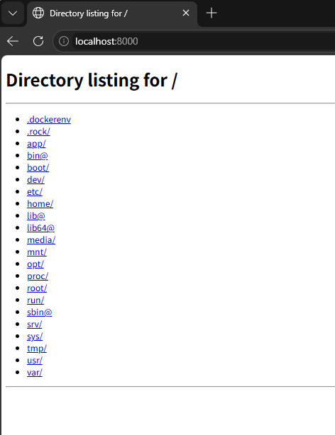
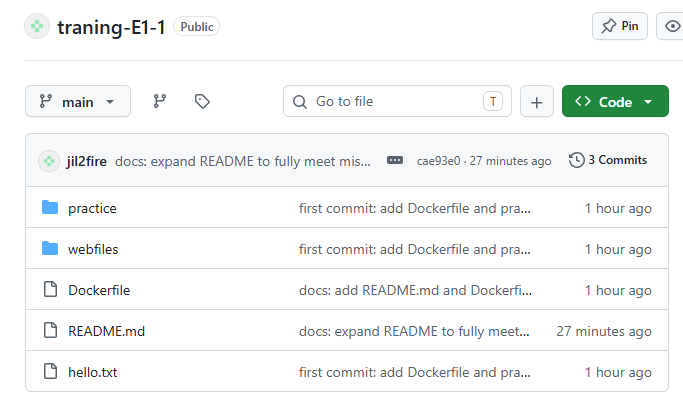

# E1-1 개발 워크스테이션 구축

## 1. 프로젝트 개요
개발 워크스테이션 환경(Linux CLI · Docker · Git/GitHub)을 **모두 CLI로 직접 구축**하고,
각 명령어의 의미와 구조적 원칙(이미지/컨테이너 분리, 격리 실행, 포트·스토리지 연결)을
실행 결과(로그·접속·데이터 유지)로 검증하는 것을 목표로 한다.
최종 산출물은 전 과정을 재현 가능하게 문서화한 본 저장소다.

> 본 README만 읽고도 평가자가 동일 절차를 따라 결과를 재현할 수 있도록 작성했다.

---

## 2. 실행 환경
| 항목 | 내용 |
|------|------|
| OS (호스트) | Windows 11 Home |
| 리눅스 | WSL2 · Ubuntu 26.04.1 LTS |
| 쉘 / 터미널 | bash (Ubuntu WSL 터미널) |
| 커널 | 6.18.54.1-microsoft-standard-WSL2 |
| Docker | 29.9.2 (build a82e528) |
| Git | 2.53.0 |
| 작업 디렉터리 | /home/cari6/codyssey |

---

## 3. 수행 항목 체크리스트
- [x] 터미널 기본 조작 (pwd, whoami, ls -la, cd, mkdir, touch, cat, echo, cp, mv, rm)
- [x] 파일/디렉토리 권한 변경 실습 (전/후 비교)
- [x] Docker 설치 및 데몬 점검 (docker --version / docker info)
- [x] Docker 운영 (images, ps, ps -a, logs, stats, stop)
- [x] 컨테이너 실행 (hello-world) 및 ubuntu 내부 진입 (attach/exec 관찰)
- [x] Dockerfile 직접 작성 및 커스텀 이미지 빌드 (my-web-server:1.0)
- [x] 포트 매핑 및 접속 검증 (-p 8000:8000 → curl)
- [x] 바인드 마운트 반영 (호스트 변경 전/후)
- [x] Docker 볼륨 영속성 (컨테이너 삭제 전/후)
- [x] Git 설정 + GitHub 저장소 연동 (config, init, add, commit, remote, push)

---

## 4. 터미널 조작 로그

### 4.1 디렉터리 생성 / 이동 (mkdir · cd)
```bash
$ cd ~                     # 홈 디렉터리로 이동
$ mkdir codyssey           # 작업 폴더 생성
$ cd codyssey              # 생성한 폴더로 진입
$ pwd                      # 이동 성공 확인
/home/cari6/codyssey

$ mkdir practice           # 실습용 하위 폴더 생성
$ cd practice              # 만든 폴더로 진입
$ pwd
/home/cari6/codyssey/practice

$ cd ..                    # 상위(부모) 폴더로 복귀
$ pwd
/home/cari6/codyssey
```
- `mkdir`·`cd`는 성공 시 별도 출력이 없으므로, `pwd`로 폴더 생성·이동 결과를 확인했다.
- `cd ~`는 홈 디렉터리, `cd ..`는 상위(부모) 폴더로 이동한다.

### 4.2 위치/목록/내용 확인
```bash
$ pwd
/home/cari6/codyssey

$ whoami
cari6

$ ls -la
total 36
drwxr-xr-x 5 cari6 cari6 4096 Nov  3 15:18 .
drwxr-x--- 7 cari6 cari6 4096 Nov  3 15:18 ..
drwxr-xr-x 7 cari6 cari6 4096 Nov  3 15:18 .git
-rw-r--r-- 1 cari6 cari6  114 Nov  3 15:18 Dockerfile
-rwxr--r-- 1 cari6 cari6 4235 Nov  3 15:18 README.md
-rw-r--r-- 1 cari6 cari6   15 Nov  2 19:37 hello.txt
drwxr-xr-x 4 cari6 cari6 4096 Nov  2 14:54 practice
drwxr-xr-x 2 cari6 cari6 4096 Nov  3 14:52 webfiles

$ cat hello.txt
Hello Codyssey
```
- `ls -la` : `-l`(자세히) + `-a`(숨김 파일 `.git` 등 포함)

### 4.3 생성 / 이어쓰기 / 복사 / 이름변경 / 삭제
```bash
$ touch hello.txt
$ echo "Hello Codyssey" > hello.txt      # > 덮어쓰기
$ cat hello.txt
Hello Codyssey

$ echo "Second line" >> hello.txt        # >> 이어쓰기
$ cat hello.txt
Hello Codyssey
Second line

$ cp hello.txt copy.txt                  # 복사
$ ls
copy.txt  hello.txt

$ mv copy.txt renamed.txt                # 이동/이름변경
$ ls
hello.txt  renamed.txt

$ rm renamed.txt                         # 삭제 (영구)
$ ls
hello.txt
```
- `>` = 덮어쓰기(새로 작성), `>>` = 이어쓰기(기존 내용 보존)
- `rm`은 휴지통 없이 영구 삭제되므로 주의

---

## 5. 권한 실습 (전/후 비교)

### 권한 읽는 법
`-rw-r--r--` → 맨 앞 1글자(종류: `-`파일/`d`폴더) + 3글자씩 [소유자][그룹][기타]
권한 숫자: **r=4, w=2, x=1** 을 합산 → 644=`rw-r--r--`, 755=`rwxr-xr-x`, 700=`rwx------`

### 5.1 파일 권한 변경 (hello.txt)
```bash
$ ls -l hello.txt            # 변경 전
-rw-r--r-- 1 cari6 cari6 15 Nov  2 19:37 hello.txt

$ chmod 777 hello.txt
$ ls -l hello.txt            # 변경 후
-rwxrwxrwx 1 cari6 cari6 15 Nov  2 19:37 hello.txt

$ chmod 644 hello.txt        # 복구
$ ls -l hello.txt
-rw-r--r-- 1 cari6 cari6 15 Nov  2 19:37 hello.txt
```

### 5.2 디렉토리 권한 변경 (practice/)
```bash
$ ls -ld practice            # 변경 전
drwxr-xr-x 4 cari6 cari6 4096 Nov  2 14:54 practice

$ chmod 700 practice
$ ls -ld practice            # 변경 후
drwx------ 4 cari6 cari6 4096 Nov  2 14:54 practice

$ chmod 755 practice         # 복구
$ ls -ld practice
drwxr-xr-x 4 cari6 cari6 4096 Nov  2 14:54 practice
```
> 디렉토리는 진입(`cd`)에 `x` 권한이 필요하므로 보통 755를 사용한다.
> (주의: WSL의 `/mnt/c` 같은 Windows 마운트 경로에서는 chmod가 정상 반영되지 않아, Linux 홈 경로에서 실습했다.)

---

## 6. Docker 설치 및 점검
```bash
$ docker --version
Docker version 29.9.2, build a82e528

$ docker info
...
Server:
 Containers: 4
  Running: 0
 Images: 3
 Server Version: 29.9.2
 Operating System: Ubuntu 26.04.1 LTS
 Kernel Version: 6.18.54.1-microsoft-standard-WSL2
...
```
`docker info`의 **Server 섹션**이 출력되므로 데몬이 정상 동작함을 확인.

---

## 7. Docker 기본 운영
```bash
$ docker images
IMAGE                ID             DISK USAGE   CONTENT SIZE   EXTRA
hello-world:latest   c567b231f656       25.9kB         9.49kB   U
my-web-server:1.0    41631a3dfb19        299MB         88.8MB   U
my-web:1.0           873fbb9e3b09       93.6MB         26.3MB   U
ubuntu:latest        6a06111c3b0a        163MB         45.9MB   U

$ docker ps          # 실행 중인 컨테이너만
CONTAINER ID   IMAGE     COMMAND   CREATED   STATUS    PORTS     NAMES

$ docker ps -a       # 멈춘 것 포함 전체
CONTAINER ID   IMAGE               COMMAND                  STATUS                    NAMES
8262cdea7b94   my-web-server:1.0   "python3 -m http.ser…"   Exited (255)              my-web
19b1634f0778   hello-world         "/hello"                 Exited (0)                stoic_ramanujan
2598845fd6a3   hello-world         "/hello"                 Exited (0)                hello

$ docker logs hello
Hello from Docker!
This message shows that your installation appears to be working correctly.
...

$ docker stats        # 실시간 자원 사용 (Ctrl+C로 종료)
CONTAINER ID   NAME      CPU %     MEM USAGE / LIMIT   MEM %     NET I/O   BLOCK I/O   PIDS
# (실행 중 컨테이너가 없어 데이터 행 없음)
```

---

## 8. 컨테이너 실행 실습

### 8.1 hello-world
```bash
$ docker run hello-world
Hello from Docker!
This message shows that your installation appears to be working correctly.
...
```

### 8.2 ubuntu 내부 진입
```bash
$ docker run -it ubuntu bash
root@ccb24024b48f:/# ls
bin  boot  dev  etc  home  lib  lib64  media  mnt  opt  proc  root  run  sbin  srv  sys  tmp  usr  var
root@ccb24024b48f:/# pwd
/
root@ccb24024b48f:/# exit
exit
```
- `-it` : `-i`(입력 가능) + `-t`(터미널) → 컨테이너 내부 bash로 진입
- 프롬프트가 `cari6@hjh`(호스트) → `root@...`(컨테이너)로 바뀌어 **격리된 실행 환경**임을 확인

### 8.3 attach vs exec (관찰 정리)
- `docker run -it ... bash` : 컨테이너를 **새로 만들며** 내부 쉘로 진입. `exit` 시 컨테이너도 종료됨.
- `docker exec -it <컨테이너> bash` : **이미 실행 중인** 컨테이너 안에서 **새 프로세스(bash)**를 띄워 진입. `exit` 해도 컨테이너는 계속 실행됨. (아래 8단계에서 `docker exec my-web ls /app`로 실제 사용)
- `docker attach` : 실행 중 컨테이너의 메인 프로세스 화면에 그대로 붙음(입출력 공유).
→ 운영 중 컨테이너 내부 점검에는 **exec**가 안전하다.

### 8.4 컨테이너 중지 (docker stop)
```bash
$ docker run -d -p 8000:8000 --name stop-test my-web-server:1.0
1dc8a31ab103...

$ docker ps                      # 실행 중 (STATUS: Up)
CONTAINER ID   IMAGE               STATUS                  PORTS                     NAMES
1dc8a31ab103   my-web-server:1.0   Up Less than a second   0.0.0.0:8000->8000/tcp    stop-test

$ docker stop stop-test          # 정상 종료 요청
stop-test

$ docker ps -a                   # 중지 후 (STATUS: Exited)
CONTAINER ID   IMAGE               STATUS                 NAMES
1dc8a31ab103   my-web-server:1.0   Exited (137) ... ago   stop-test

$ docker rm stop-test            # 테스트 컨테이너 정리
stop-test
```
- `docker stop`은 컨테이너에 종료 신호를 보내 **정상 중지**시킨다. `Up` → `Exited` 로 상태가 바뀌는 것으로 확인.

---

## 9. 커스텀 이미지 제작 (Dockerfile)

### 선택한 방식: (B) Linux 베이스 이미지 + 기능 추가
- **기존 베이스:** `ubuntu:latest` — 범용 Linux 환경을 기반으로 선택.
- **커스텀 포인트와 목적:**
  1. `RUN apt-get update && apt-get install -y python3` — 정적 파일 제공용 웹서버를 띄우기 위해 Python3를 설치.
  2. `CMD ["python3","-m","http.server","8000"]` — 컨테이너 시작 시 자동으로 8000 포트 웹서버를 실행(설정을 코드로 고정 → 재현성 확보).

### Dockerfile ([전체 보기](./Dockerfile))
```dockerfile
FROM ubuntu:latest
RUN apt-get update && apt-get install -y python3
CMD ["python3", "-m", "http.server", "8000"]
```

### 빌드 & 실행
```bash
$ docker build -t my-web-server:1.0 .
[+] Building 81.7s (6/6) FINISHED
 => naming to docker.io/library/my-web-server:1.0        # 빌드 성공

$ docker run -d --name my-web my-web-server:1.0
9962d7ba1f22...                                          # 백그라운드 실행

$ docker ps
CONTAINER ID   IMAGE               COMMAND                  STATUS         NAMES
9962d7ba1f22   my-web-server:1.0   "python3 -m http.ser…"   Up 50 seconds  my-web
```

---

## 10. 포트 매핑 및 접속 증거
```bash
$ docker run -d -p 8000:8000 --name my-web my-web-server:1.0
ce614c1fca36...

$ docker ps
PORTS: 0.0.0.0:8000->8000/tcp, [::]:8000->8000/tcp      # 호스트:8000 ↔ 컨테이너:8000

$ curl http://localhost:8000
<!DOCTYPE HTML>
<html lang="en">
<head><title>Directory listing for /</title></head>
<body>
<h1>Directory listing for /</h1>
...
</body></html>                                           # 웹서버 정상 응답 확인
```
- `-p 호스트포트:컨테이너포트` 로 외부에서 컨테이너 내부 서비스에 접속 가능해진다.
- 접속 대상 정적 파일: [`webfiles/`](./webfiles)



---

## 11. 바인드 마운트 반영 (호스트 변경 전/후)
```bash
$ docker run -d -p 8000:8000 --name my-web -v ~/codyssey/webfiles:/app my-web-server:1.0

$ docker exec my-web ls /app          # 변경 전
index.html

$ echo "<h1>New File!</h1>" > ~/codyssey/webfiles/new.html   # 호스트에서 파일 추가

$ docker exec my-web ls /app          # 변경 후 (재시작 없이 즉시 반영)
index.html
new.html
```
- `-v 호스트경로:컨테이너경로` : 호스트 폴더와 컨테이너 폴더를 실시간 연결.

---

## 12. Docker 볼륨 영속성 (컨테이너 삭제 전/후)
```bash
$ docker volume create my-volume
my-volume

$ docker volume ls
DRIVER    VOLUME NAME
local     my-volume

$ docker run -it --name vol-test -v my-volume:/data ubuntu bash
root@7c532bc10e37:/# echo "볼륨 데이터 테스트!" > /data/test.txt
root@7c532bc10e37:/# cat /data/test.txt
볼륨 데이터 테스트!
root@7c532bc10e37:/# exit

$ docker rm vol-test                  # 컨테이너 삭제
vol-test

$ docker run --rm -v my-volume:/data ubuntu cat /data/test.txt   # 새 컨테이너로 확인
볼륨 데이터 테스트!                    # 컨테이너를 삭제했어도 데이터 유지됨 ✅
```
- 볼륨은 컨테이너 수명과 분리되어 데이터가 영속된다. (`--rm` = 실행 후 자동 삭제)

---

## 13. Git 설정 및 GitHub 연동
```bash
$ git --version
git version 2.53.0

$ git config --global user.name "******"
$ git config --global user.email "******@gmail.com"
$ git config --global init.defaultBranch main    # 새 저장소 기본 브랜치를 main으로 설정
$ git config --list
user.name=jil2fire
user.email=hjhoffice721@gmail.com
init.defaultbranch=main
credential.helper=store

$ git init                 # 로컬 저장소 초기화
$ git branch -m main       # 현재 브랜치 이름을 main으로 변경
$ git add .                # 스테이징
$ git commit -m "first commit: add Dockerfile and practice files"
$ git remote add origin https://github.com/jil2fire/traning-E1-1.git
$ git push -u origin main  # GitHub 업로드

$ git log --oneline
709c1e0 docs: add README.md and Dockerfile
fe2f4f7 first commit: add Dockerfile and practice files
```
- **Git(로컬 버전관리)** 과 **GitHub(원격 협업 플랫폼)** 의 역할 차이를 적용: 로컬에서 commit으로 이력을 남기고, push로 원격(GitHub)에 공유한다.
- 저장소: https://github.com/jil2fire/traning-E1-1 (공개)



---

## 14. 트러블슈팅 (문제 → 원인 가설 → 확인 → 해결)

### 14.1 `git push` 시 `invalid credentials` 인증 실패
- **문제:** push 중 비밀번호 입력 후 `remote: invalid credentials`로 실패.
- **원인 가설:** ① 비밀번호가 아니라 토큰이 필요한 것 아닌가? ② 입력 시 공백이 섞인 것 아닌가?
- **확인:** GitHub 공식 정책상 2021년부터 비밀번호 인증 폐지됨을 확인. 일반 비밀번호로는 계속 실패.
- **해결:** Personal Access Token(PAT, classic · repo 권한) 발급 → `git config --global credential.helper store` 설정 후 비밀번호 자리에 토큰 입력 → push 성공.
- **보안 주의:** 토큰은 문서/로그/저장소에 노출하지 않으며, 노출 시 즉시 폐기·재발급한다.

### 14.2 PowerShell에서 `docker` 명령을 인식하지 못함
- **문제:** Windows PowerShell에서 `docker` 입력 시 "명령을 찾을 수 없음".
- **원인 가설:** Docker가 Windows PATH에 없고 WSL 내부에만 설치된 것 아닌가?
- **확인:** WSL Ubuntu 터미널에서 `docker --version` 실행 시 정상 출력됨을 확인.
- **해결:** 모든 Docker 작업을 WSL Ubuntu 터미널 안에서 수행.

### 14.3 (추가) `chmod` 권한이 Windows 경로에서 반영되지 않음
- **문제:** 처음에 `/mnt/c`(Windows Desktop) 경로에서 작업하려 했으나 권한 실습에 부적합.
- **원인 가설:** Windows 파일시스템 마운트는 Linux 권한 모델을 완전히 지원하지 않는 것 아닌가?
- **확인:** `/mnt/c`에서는 chmod 결과가 `ls -l`에 제대로 반영되지 않음.
- **해결:** Linux 홈 경로(`/home/cari6/codyssey`)에서 작업하여 권한 실습이 정상 동작.

---

## 15. 과제 개념 정리 (스스로 설명 가능해야 할 것)
- **절대경로 vs 상대경로:** 절대경로는 `/`로 시작해 어디서든 동일(`/home/cari6/codyssey`), 상대경로는 현재 위치 기준(`webfiles`, `../practice`).
- **권한 r/w/x & 755/644:** r=4·w=2·x=1 합산. 644=소유자 읽기/쓰기+그룹·기타 읽기(일반 파일), 755=소유자 전체+그룹·기타 읽기/실행(폴더·실행파일).
- **커스텀 이미지:** 기존 베이스 이미지(ubuntu)에 패키지 설치·실행 명령을 더해 Dockerfile로 재현 가능한 나만의 이미지를 만든다.
- **포트 매핑이 필요한 이유:** 컨테이너는 격리돼 있어 내부 포트가 외부에 자동 노출되지 않는다. `-p`로 호스트 포트와 연결해야 접속 가능.
- **볼륨(영속 데이터):** 컨테이너를 삭제해도 데이터를 보존하기 위한 Docker 관리 저장소.
- **Git vs GitHub:** Git은 로컬 버전관리 도구, GitHub은 원격 저장·협업 플랫폼.

---

## 16. 보안 유의사항
- 토큰·비밀번호·개인키·인증코드 등 민감정보는 로그·스크린샷·문서에서 **마스킹**한다.
- 실제 PAT 토큰은 저장소 밖(`~/.git-credentials`)에 보관되며, 본 저장소에는 포함되지 않는다.
- 민감정보 노출이 의심되면 즉시 제거하고 재발급 절차를 수행한다.

---

## 17. 저장소 구성
```
.
├── Dockerfile          # 커스텀 웹서버 이미지 정의
├── README.md           # 본 문서 (전체 수행 로그·증거)
├── hello.txt           # 터미널/권한 실습 파일
├── images/             # 증거 스크린샷
│   ├── browser.png     # 포트 매핑 브라우저 접속 화면
│   └── github.png      # GitHub 저장소 연동 화면
├── practice/           # 터미널 실습 디렉토리
└── webfiles/           # 바인드 마운트 대상 정적 파일
    ├── index.html
    └── new.html
```
